<div align="center">


# Ant Arena

### Learning your team actually plays.

**Daily quiz sprints · Comic-book Story Mode · 3D Arena Map · Big-screen live games · Instant polls · Certification** — all under your own brand.

[](LICENSE)


[**Live site**](https://antarena.vercel.app) · [**Try the free demo**](https://antarena.vercel.app/#/experience) · [**Product guide**](PRODUCT.md) · [**Security**](SECURITY.md)

<br />

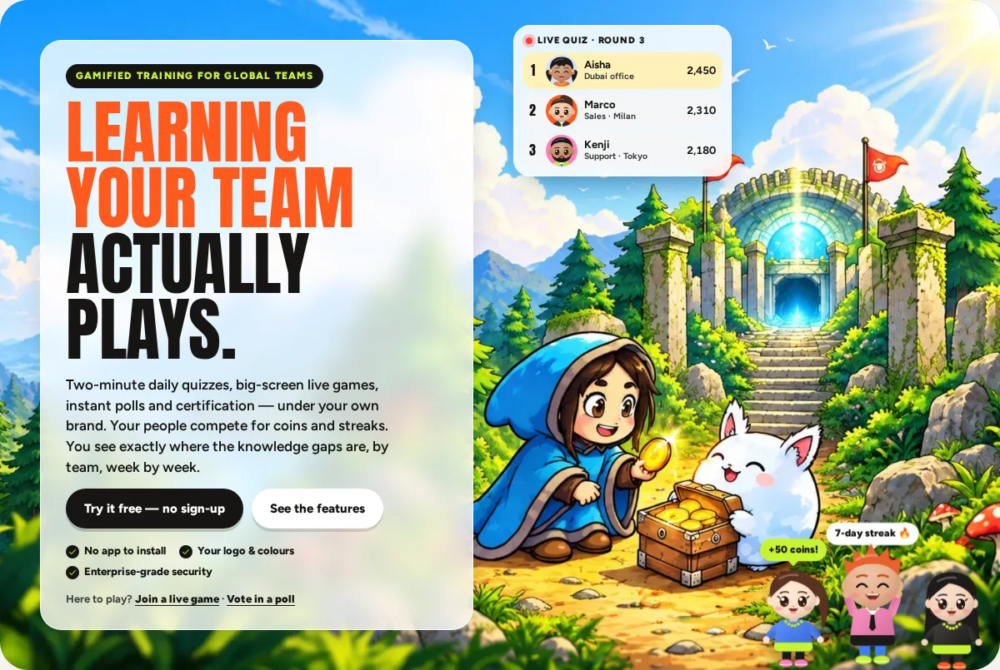

</div>

---

## ✨ What is Ant Arena?

Ant Arena is a **white-label, multi-company platform** that turns employee training into two minutes of fun a day. Staff play short daily quizzes on their phones and travel a 3D journey map, read case studies as comic books, compete in game-show live quizzes at town halls, vote in live polls, and earn branded certificates, while managers see exactly where the knowledge gaps are.

You run one installation. As the **super admin**, you create a private space for each client company, with its own web address, name, logo, colours, admins, players and questions. No company can see another's data.

> 📘 Writing a proposal, pitch deck or poster? Everything is in the **[Product guide (PRODUCT.md)](PRODUCT.md)**.

## 🎮 Five products in one

| | |
|---|---|
| 🏃 **Daily Sprint** | 2-minute quizzes with 6 question types (incl. **swipe sort** and **buckets**), partial marks and a fair **second chance**, on a **3D Arena Map** of floating lands; coins, streaks, levels, leaderboards, team battles and 18 painted 3D characters with a store of **pets**, **rides**, hats and glasses in the same style |
| 📖 **Story Mode** | Case studies as animated **comic books**: the app's characters in 7 moods, speech bubbles, sound effects, choices, a rank stamp and a replay. Admins write a story like a play (or bulk-import many) and preview it |
| 🏆 **Live Quiz** | Kahoot-style game show: game PIN + QR, answer tiles, race-track scoreboard and a confetti podium finale |
| 📊 **Live Polls** | Mentimeter-style: word cloud, multiple choice, scale, ranking, open text, Q&A, guess the number, 100 points, 2×2 grid, pin on image, plus text and image slides |
| 🎓 **Certification** | Timed exams with pass marks, attempts and expiry, and printable certificates with an editable signature and seal |

## 📸 A look inside

<table>
  <tr>
    <td width="50%">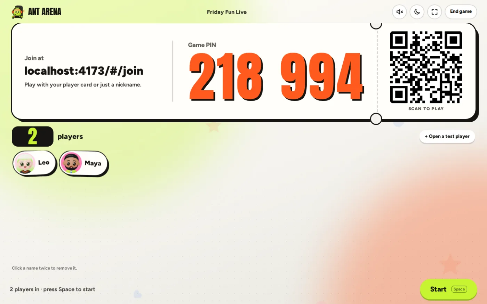<br /><sub><b>Live quiz lobby:</b> giant PIN, QR code, players popping in</sub></td>
    <td width="50%">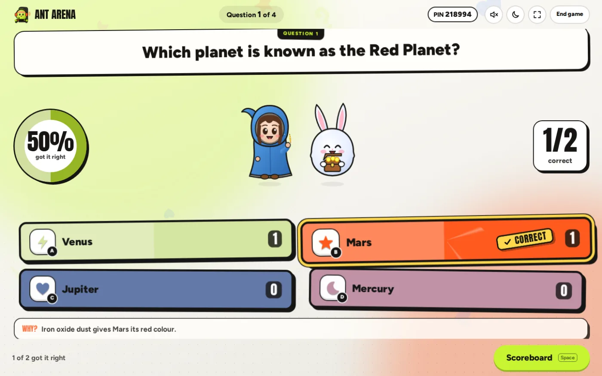<br /><sub><b>Answer reveal:</b> correct stamp, answer counts, explanation</sub></td>
  </tr>
  <tr>
    <td>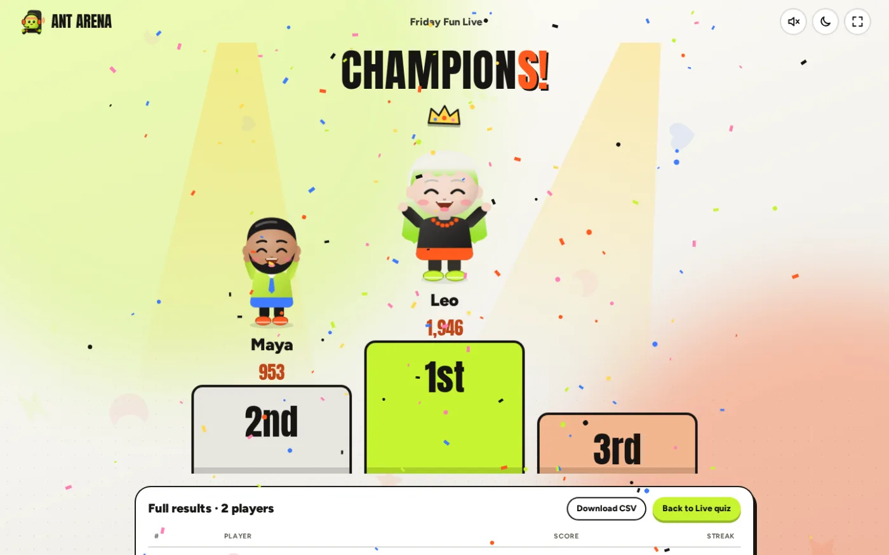<br /><sub><b>Podium finale:</b> spotlights, crown and confetti</sub></td>
    <td>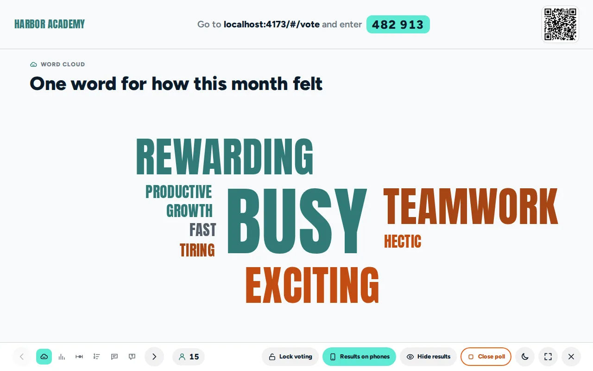<br /><sub><b>Live polls:</b> a word cloud that grows as people type</sub></td>
  </tr>
  <tr>
    <td>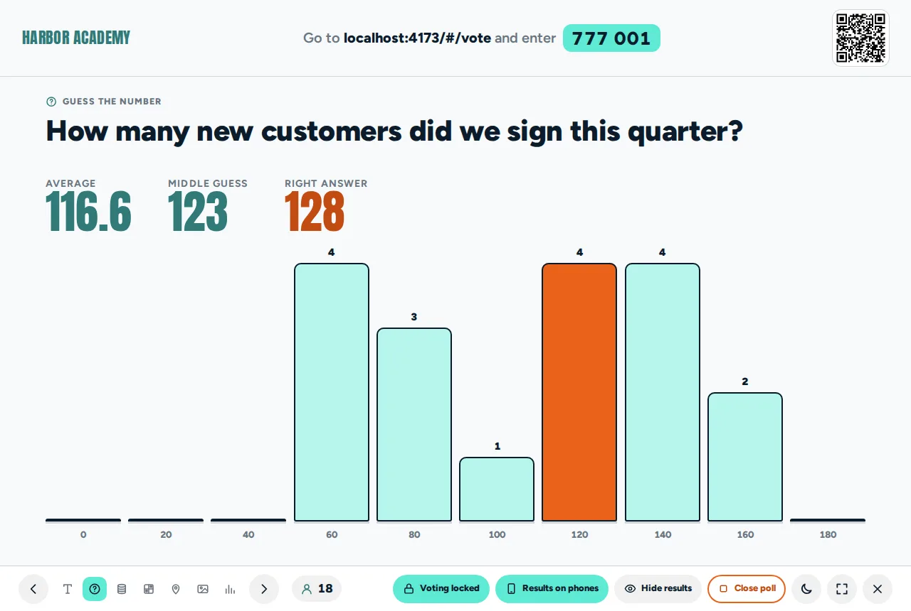<br /><sub><b>Guess the number:</b> the answer is revealed when voting locks</sub></td>
    <td>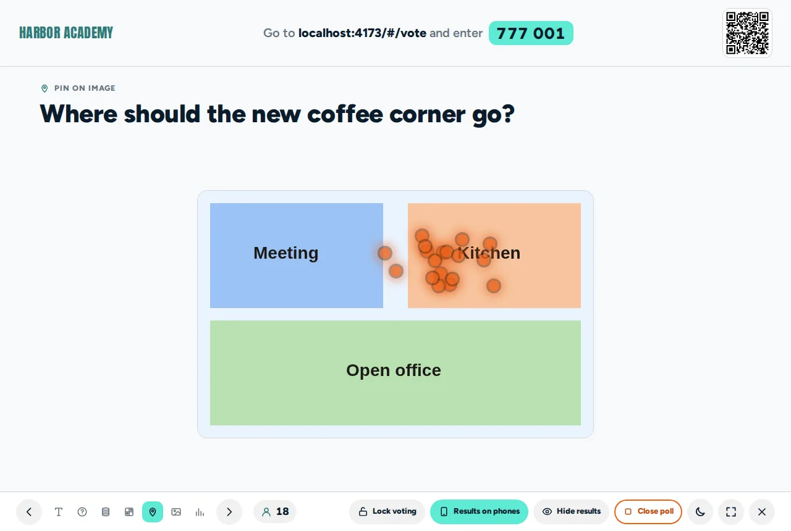<br /><sub><b>Pin on image:</b> every tap lands live on the picture</sub></td>
  </tr>
  <tr>
    <td>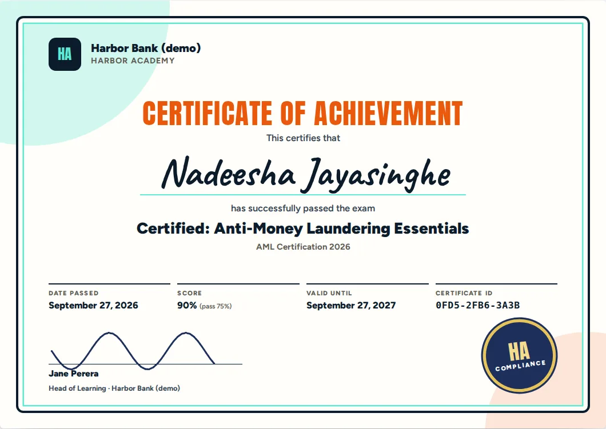<br /><sub><b>Certificates:</b> branded, with signature, seal and unique ID</sub></td>
    <td>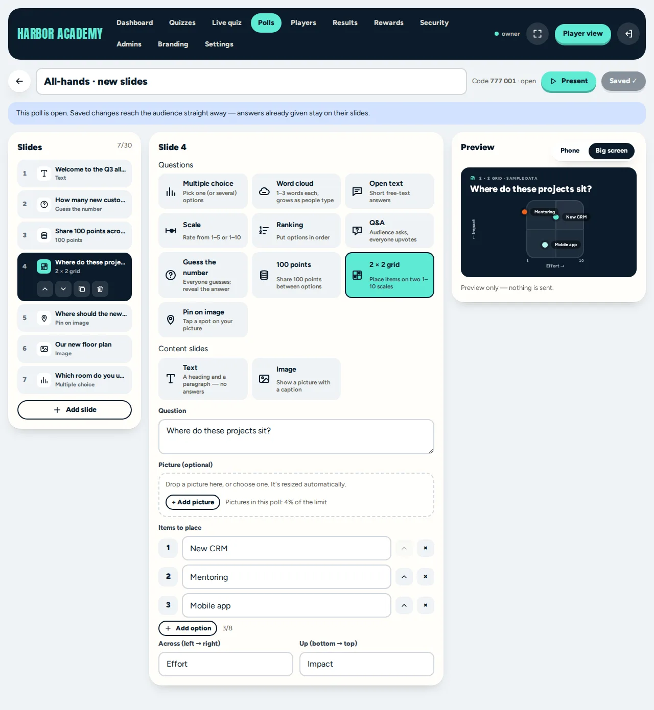<br /><sub><b>Poll editor:</b> 12 slide types with a live big-screen preview</sub></td>
  </tr>
</table>

<p align="center">
  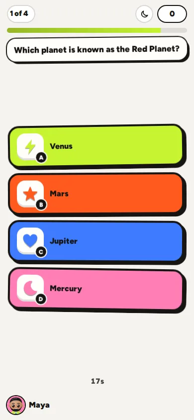
  &nbsp;&nbsp;
  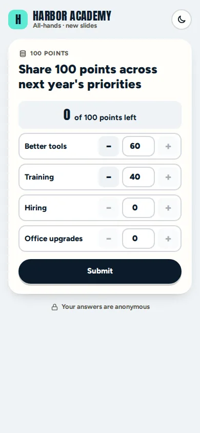
</p>
<p align="center"><sub>No app to install: players answer on any phone browser.</sub></p>

## 🔒 Built for enterprise trust

Row-level tenant isolation · server-side scoring · 5 admin roles with maker-checker approvals · authenticator-app MFA · private invite links · rate limits · full audit trail · strict security headers. See **[SECURITY.md](SECURITY.md)**.

## 🎨 Truly white-label

Each client gets its own product name, logo, colours (with automatic readability checks) and wording, across the player app, admin portal, big screens, certificates and PDF reports. Live screens come in **light mode by default**, with dark mode one tap away.

---

# 🛠️ Developer guide

**Stack:** React 18 + TypeScript + Vite · Supabase (Postgres + Row Level Security, Auth, Realtime) · Vercel.

## 1. Try it in 30 seconds (no setup)

```bash
npm install
npm run dev          # http://localhost:5173
```

With no Supabase keys, the app runs a full **demo backend inside the browser** (data is kept in localStorage):

| What | Where | Sign in |
|---|---|---|
| Landing page | `#/` | — |
| Experience (guided demo tour) | `#/experience` | — |
| Sign in (join a game, vote, company & admin sign-in) | `#/signin` | — |
| Harbor Bank, player app (bank template, custom brand) | `#/t/harbor` | Employee ID `DEMO-101` … `DEMO-130` — try the **Arena Map**, the **Story Mode** shelf and the "New: swipe & sort" quiz |
| Harbor Bank, admin portal | `#/t/harbor/admin` | `admin@harbor.demo` / `demo1234` (Owner) · `host@harbor.demo` / `demo1234` (Host) |
| Northwind Traders (generic template) | `#/t/northwind` · `/admin` | `admin@northwind.demo` / `demo1234` |
| Live poll (audience) | `#/vote/482913` | anonymous |
| Super admin console | `#/super` | `super@demo.app` / `demo1234`, then the authenticator code shown on screen |

In the demo, email codes and links appear in a blue "Demo inbox" box instead of being emailed. To test a live game, host it from the admin portal and press **+ Open a test player** to open player tabs.

**Demo sandbox on a live site.** When Supabase is configured, visitors can still try everything from `#/experience`: the first click switches their browser to the in-browser demo (a "Demo sandbox · Exit demo" bar stays on screen). Nothing they do is sent to the database; it's kept in their browser's localStorage.

**SEO & speed.** `npm run build` pre-renders the landing page into `index.html` and each section into its own page (`/features`, `/how-it-works`, `/use-cases`, `/security`, `/faq` — real HTML for search engines and a fast first paint; the app hydrates it), adds Open Graph/Twitter cards, JSON-LD (Organization, SoftwareApplication, FAQPage, breadcrumbs), `robots.txt` and `sitemap.xml`. Canonical and share URLs use `VITE_APP_URL` (else Vercel's production domain), so changing the domain needs no code change. The build stops if the inline script's hash in `vercel.json`'s CSP is out of date. Brand assets (favicon, app icons, social image) are generated from `src/components/Logo.tsx` with `npm run gen:brand`.

`npm run build:demo` produces **one self-contained HTML file** (`dist-demo/index.html`) that you can email to a prospect or open from disk.

## 2. Open in Cursor

1. Unzip, then **File → Open Folder…** and pick the project folder.
2. Open the terminal (`` Ctrl+` ``) and run `npm install`, then `npm run dev`.
3. Useful commands: `npm run typecheck`, `npm run build`, `npm run build:demo`.

Where things live:

```
src/
  api/Api.ts            the backend contract (every data operation)
  api/demo/             in-browser demo backend (same rules as production)
  api/supabase/         production backend client
  api/engine.ts         shared rules: live points, poll results, default settings
  lib/scoring.ts        points, coins, levels, streaks, leaderboards (also shown in the in-app guide)
  lib/answers.ts        question types: drafts ↔ sealed questions, partial scoring (swipe, bucket, story)
  lib/storyScript.ts    Story Mode script format (parse ↔ write), moods, roles, looks
  lib/importQs.ts       bulk import for every question type, story blocks and scripts
  lib/arenaMap.ts       Arena Map: lands, stops, castles, chests from quizzes + plays
  pages/                home, section pages (SEO), company player app, admin gate
  player/               Daily Sprint, Story Mode, Second chance, Arena Map, store, certification (player side)
  player/qtypes.tsx     swipe sort, buckets and the comic-book Story Mode player
  player/map3d/         the 3D Arena Map (three.js): islands, people, animals, sound, sky & ambience
  components/           characters (Chibi → Painted art in assets/art), pets & rides (Companions), UI kit
  admin/                company admin portal (dashboard, quizzes, story editor, players, results, rewards, security, admins, branding, settings)
  live/                 live quiz: admin tab, host screen, phone controller
  polls/                live polls: editor, presenter screen, voting page
  cert/                 printable certificate
  super/                super admin console
supabase/               SQL migrations, seed, backend README
```

**Question images:** every quiz question can carry a picture. The admin portal resizes and compresses it in the browser (about 50–250 KB) and it's stored with the question.

**Writing content fast.** Every editor has a **Bulk import** panel: paste rows from Excel or upload a `.csv` / `.txt`. Rows start with a type word — `MCQ`, `TF`, `MATCH`, `ORDER`, `SWIPE`, `BUCKET` — and Story Mode accepts scripts (`Title:` … `Name (mood): words` … `- Best: reply -> (mood) what happens`) or spreadsheet blocks (`STORY` · `CAST` · `SCENE` · `CHOICE` · `END`). The panel shows an example for each and explains any row it skips.

**Updating an existing Supabase project:** run only the migrations you haven't run yet, in number order. Each one is safe to run more than once.

## 3. Set up Supabase (free plan)

1. Create a project at [supabase.com](https://supabase.com) (the free plan is fine to start).
2. In **SQL Editor**, run these files in order: `supabase/migrations/0001_schema.sql`, `0002_security.sql`, `0003_functions.sql`, `0004_question_images.sql`, `0005_live_player_count.sql`, `0006_super_self_approve.sql`, `0007_rename_ant_arena.sql`, `0008_special_characters.sql`, `0009_super_requires_authenticator.sql`, `0010_mfa_reset_by_email.sql`, `0011_private_invite_links.sql`, `0012_certificate_signature.sql`, `0013_poll_slide_types.sql`, `0014_super_admin_authenticator_only.sql`, `0015_passwords.sql`, `0016_units_and_live_join.sql`, `0017_new_types_second_chance.sql`, `0018_story_mode.sql`, `0019_store_pets_rides.sql`, `0020_untimed_sprints.sql`, then `supabase/seed.sql`.
3. Make yourself super admin: `select public.bootstrap_super_admin('you@yourmail.com');`
4. In **Authentication**, turn **Anonymous sign-ins ON**, set the **email OTP length to 6**, enable **MFA (TOTP)**, add your redirect URLs, and raise the anonymous sign-in rate limit. The full checklist is in `supabase/README.md` §3.
5. Copy `.env.example` to `.env.local` and fill in `VITE_SUPABASE_URL` and `VITE_SUPABASE_ANON_KEY` (**Project Settings → API**).
6. Run `npm run dev`. The app now uses Supabase. Open `#/super`, sign in with your email and password, then scan the QR code with an authenticator app (Google Authenticator, Microsoft Authenticator, 1Password…) and enter the 6-digit code. Email + password + authenticator is all a super admin needs.

Optional: `npm run test:supabase` runs about 230 end-to-end checks against a Supabase stack (see `supabase/README.md`).

## 4. Deploy to Vercel

1. Push the folder to a GitHub repo, then use **Vercel → Add New → Project → Import** on it.
2. The framework is detected as **Vite**; `vercel.json` already sets the build and the security headers.
3. **Environment Variables:** add `VITE_SUPABASE_URL`, `VITE_SUPABASE_ANON_KEY` and `VITE_APP_URL` (your site address, e.g. `https://antarena.vercel.app` — used in QR codes, share links, canonical URL and sitemap).
4. Deploy. Then add the Vercel URL to Supabase → Authentication → URL Configuration (Site URL + Redirect URLs).

Routes use `#/…` hash URLs, so no rewrites are needed and links work anywhere.

## 5. Onboard a client

1. `#/super` → **New company**. Enter the name, the web address (e.g. `acme-bank`), the template (**Bank** = Branch/Department wording, maker-checker and admin MFA on), the owner's email, brand colours and logo, and whether to include the starter library.
2. Send the owner the two links the wizard shows:
   - player link: `https://your-app/#/t/acme-bank`
   - admin link: `https://your-app/#/t/acme-bank/admin`

   The owner signs in with that email ("First time? Set a password").
3. The owner invites their own admins (**Admins** tab: Owner, Admin, Editor, Host, Viewer), adds players (or lets staff register), edits quizzes, and sets branding and features.
4. You can suspend, edit or delete a company at any time and see usage per company.

## 6. Free-plan limits (Supabase)

- **Database:** 500 MB, which is plenty for thousands of players (use **Security → Purge old plays** for retention).
- **Realtime:** about **200 concurrent connections**. A live game or poll with more than about 200 phones at once needs **Supabase Pro ($25/month)**; no code changes. If Realtime is full, screens fall back to polling every few seconds.
- **Inactivity:** free projects pause after 7 days without activity (Pro doesn't).
- **Email:** the built-in sender only allows a few emails per hour, so add your own SMTP (e.g. Resend, Postmark or SES) before going live.

## 7. Security

See `SECURITY.md`. In short:

- **Tenant isolation** by Postgres Row Level Security.
- **Server-side scoring:** answer keys never reach players.
- **Access:** role-based access, optional or required authenticator-app MFA for admins, a required authenticator app for super admins, and rate limits on every guessable input.
- **Records and devices:** audit logs per company and for the super admin, idle sign-out, and one device at a time for Employee-ID players.
- **Headers:** strict security headers on Vercel.

## 8. License & ownership

**© 2026 Buddhi Sandeepa.** Ant Arena, its source code, design and brand are owned by Buddhi Sandeepa and released under the **[MIT License](LICENSE)**.

The demo companies (Harbor Bank, Northwind Traders) are fictional. The landing-page hero illustration should be replaced with original artwork before commercial use.

<div align="center"><br /><br /><sub>Made with 🐜 by <b>Buddhi Sandeepa</b></sub></div>
